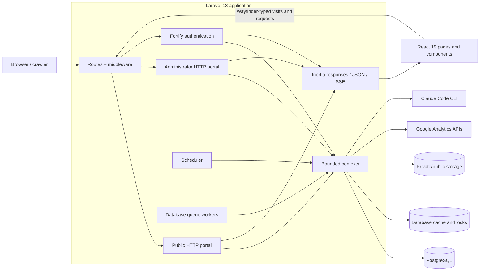
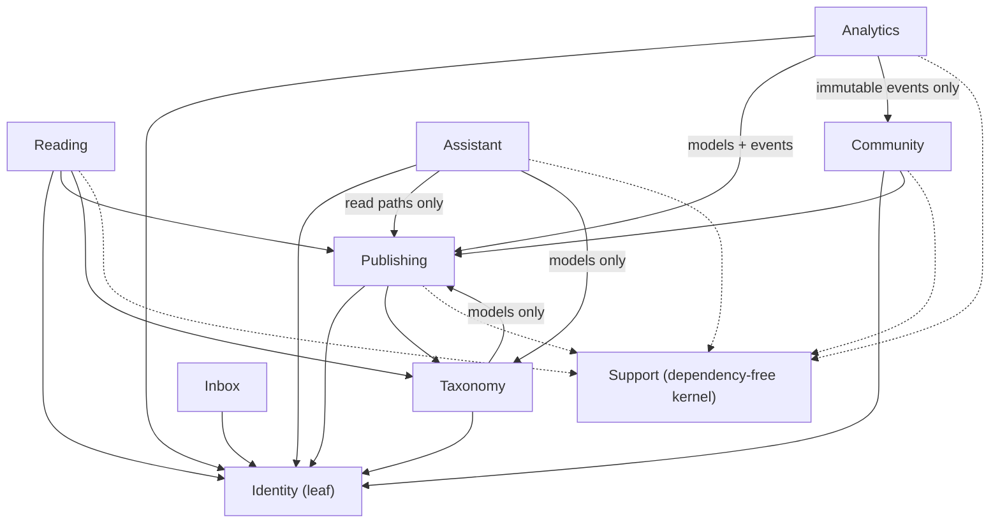
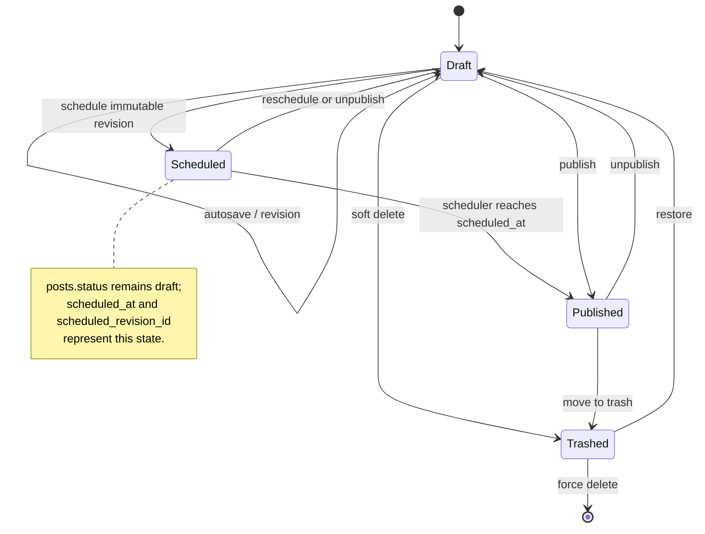
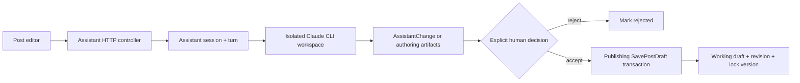

# Application architecture

Holizuki is a Laravel monolith with an Inertia React interface. It serves a
public publication, reader accounts, an administrator authoring portal,
community features, locally materialized Google Analytics reporting, and a
review-gated AI co-writer from one application and PostgreSQL database.

## System map



The PHP and JavaScript dependency versions are locked in `composer.lock` and
`package-lock.json`. The stable major-version contract is PHP 8.5, Laravel 13,
Inertia 3, React 19, Tailwind CSS 4, Fortify 1, Wayfinder 0, Pest 4, and
PostgreSQL 18 for development and production-family persistence.

## HTTP portals

Author and public routes intentionally share the root URL space; there is no
`/admin` prefix. Declaration order therefore matters. For example, `/posts` is
the author index while `/posts/{slug}` is a public article.

| Surface                  | Route source                                                                                 | Access and responsibility                                                                                          |
| ------------------------ | -------------------------------------------------------------------------------------------- | ------------------------------------------------------------------------------------------------------------------ |
| Public reading           | `routes/public.php`                                                                          | Home, articles, topics, archive, taxonomy, authors, search, static pages, feed, sitemap, robots, and view tracking |
| Public community         | `routes/community.php`                                                                       | Newsletter confirmation/unsubscribe and verified-reader comments                                                   |
| Reader account           | `routes/public.php`                                                                          | Authenticated reader password/account deletion at `/account`; readers are kept out of administrator settings       |
| Author portal            | `routes/web.php`                                                                             | Verified administrators manage analytics, posts, revisions, media, sources, taxonomy, inbox, and the assistant     |
| Community administration | `routes/community.php`                                                                       | Verified administrators moderate comments and manage subscribers                                                   |
| Author settings          | `routes/settings.php`                                                                        | Administrator profile, avatar, security, passkeys, two-factor authentication, and appearance                       |
| Authentication           | Fortify and Passkeys vendor routes, configured in `app/Providers/FortifyServiceProvider.php` | Login, reader registration, reset, verification, password confirmation, TOTP, recovery codes, and WebAuthn         |
| Health                   | `bootstrap/app.php`                                                                          | `/up` is process liveness; `/ready` proves only a database `select 1` and a default-cache write/read/delete        |

`EnsureAuthorPortalAccess` admits administrators only.
`EnsureReadersUsePublicAccountSurface` blocks reader-role users from
administrator settings and Fortify's authenticated `/user/*` management
surface. Registration creates readers; administrator accounts are created with
`php artisan user:create`.

Neither health endpoint proves queue consumption, scheduler progress, storage,
mail, Claude/Assistant availability, analytics connectivity, or SSR. Treat
those as separate operational capabilities and probes.

## Backend bounded contexts

The dependency constraints below are executable in
`tests/ArchitectureTest.php`.

| Context      | Owns                                                                                                                              | Permitted cross-context use                                                                         |
| ------------ | --------------------------------------------------------------------------------------------------------------------------------- | --------------------------------------------------------------------------------------------------- |
| `Identity`   | Users, roles, author preferences, identity events, and auth-domain actions                                                        | Leaf context; no other domain dependency                                                            |
| `Publishing` | Post aggregate, working drafts, revisions, sources, media, state transitions, metadata, markdown, policies, and publishing events | Identity plus Taxonomy; never Reading, Inbox, Community, Analytics, or Assistant                    |
| `Taxonomy`   | Categories and tags                                                                                                               | Identity and Publishing models only; never Publishing write paths                                   |
| `Reading`    | Public read queries, reader documents, SEO, public cache, and privacy-preserving post views                                       | Read-only access to Identity, Publishing, and Taxonomy                                              |
| `Inbox`      | Contact submissions                                                                                                               | Identity at most                                                                                    |
| `Community`  | Comments, moderation, newsletter double opt-in, consent, and retention                                                            | Identity and Publishing only                                                                        |
| `Analytics`  | Google Analytics gateways, imported aggregates, sync operations, insights, milestones, and author motivation                      | Identity, Publishing models/events, and immutable Community events; never another context's actions |
| `Assistant`  | Claude runtime, sessions, turns, reviewable changes, queued guided-authoring tasks, and artifacts                                 | Identity plus allowed Publishing/Taxonomy read types; never their write paths                       |
| `Support`    | Context-free slug and database helpers                                                                                            | Must not depend on Domain, HTTP, or Providers                                                       |



An arrow means "may depend on." No domain context may depend on `Assistant`,
and no domain code may depend on `App\Http`.

## Frontend architecture

`resources/js/app.tsx` is the shared Inertia v3 entry point. The Vite Inertia
plugin resolves pages from `resources/js/pages` and selects persistent layouts
by component name:

| Page name       | Layout                                                |
| --------------- | ----------------------------------------------------- |
| `public/*`      | `PublicLayout`                                        |
| `auth/*`        | `AuthLayout`                                          |
| `settings/*`    | `AppLayout` then `SettingsLayout`                     |
| `error`         | Public or administrator layout from the `portal` prop |
| everything else | `AppLayout`                                           |

The main frontend seams are:

- `resources/js/pages/` for route-level pages;
- `resources/js/layouts/` for public, authentication, administrator, and
  settings shells;
- `resources/js/components/ui/` for shared primitives;
- `resources/js/components/{public,editor,assistant,dashboard}/` for
  feature-specific presentation;
- `resources/js/hooks/` for request and state integrations;
- `resources/js/types/` for shared and page/domain prop types.

`HandleInertiaRequests` shares the authenticated user, application name,
sidebar state, flash data, community/analytics client configuration, and cached
footer categories. Keep shared props small because they accompany every
Inertia response.

Frontend calls to Laravel use generated Wayfinder imports from `@/actions` or
`@/routes`. Those directories are generated and gitignored. The Vite plugin is
configured with form variants; route/controller changes can be regenerated
explicitly with:

```bash
php artisan wayfinder:generate --with-form --no-interaction
```

Use Inertia `<Form>` for navigation-style submissions and `useHttp` for JSON or
other standalone requests. Do not add hard-coded backend URLs or Axios.

Public and administrator surfaces share a bundle but use different semantic
CSS tokens in `resources/css/public.css`, `resources/css/admin.css`, and
`resources/css/theme.css`. Public requests are eligible for SSR; authenticated
requests explicitly disable it because the editor cannot render server-side.
Production SSR is not currently running; see
[Known issues](known-issues.md#production-does-not-run-the-built-inertia-ssr-bundle).

## Critical flows

### Draft, revision, and publishing flow

`posts` is the reader-visible aggregate snapshot. Each post has a separate
one-to-one `post_drafts` working copy. Manual autosave and accepted assistant
changes both call `SavePostDraft`, which:

1. locks the post inside a transaction;
2. compares the submitted `lock_version`;
3. raises a 409 conflict unless an explicit overwrite was requested;
4. saves the working draft and draft tags;
5. increments `posts.lock_version`;
6. optionally writes an immutable revision.

Publishing copies an approved draft/revision snapshot into `posts`, syncs tags,
rebuilds reader metadata, records slug redirects when needed, writes a
published revision, and dispatches `PostPublished` after the transaction.
Scheduling keeps `status=draft` and pins `scheduled_revision_id`; the
every-minute publisher later publishes that immutable snapshot.



Featuring is orthogonal to the state machine and is allowed only for published
posts.

### AI authoring flow

The Assistant context is deliberately proposal-only:



Interactive chat/transform/metadata/outline/image turns stream validated SSE
frames from the web request. Guided plans, research, drafts, and image-passage
work create `assistant_authoring_tasks` and dispatch `RunAuthoringTask` to the
dedicated `assistant` database queue. The Assistant domain never writes
Publishing state directly. Acceptance is re-resolved against the current post
and passes through the same optimistic-lock pipeline as a manual save.

The current worker topology does not consume the dedicated queue; see
[Known issues](known-issues.md#guided-authoring-jobs-are-not-consumed-by-the-configured-workers).

### Public reading and community flow

Reading queries only published posts and builds a reader-safe document with
citations, table of contents, adjacent/related articles, and SEO props. Old
slugs permanently redirect through `post_redirects`. View tracking stores at
most one daily `(post, visitor hash)` record and is pruned by the scheduler.

Verified readers may submit comments. Reader comments begin pending; an
administrator reply is immediately approved. Newsletter subscription is
double-opt-in and stores hashes for lookup tokens and normalized identity.
Retention rules are summarized in
[Database ERD and data dictionary](database-erd.md#retention-and-sensitive-data).

### Analytics flow

Google Analytics API access is behind `AnalyticsReportingGateway` and
`AnalyticsAdminGateway`. Scheduled syncs first run health checks, reconcile URL
aliases, fetch reports under a global cache lock, and transactionally persist
daily/weekly/period aggregates. Dashboards read these local tables, not the
remote API on every request. Sync completion increments a cache version;
insights and milestones are derived from persisted evidence.

## Cross-context event reactions

Event listeners are registered explicitly in domain service providers.

| Event source | Events                                                                  | Reaction                                                                 |
| ------------ | ----------------------------------------------------------------------- | ------------------------------------------------------------------------ |
| Publishing   | publish, unpublish, schedule, trash, feature, unfeature, content update | Reading flushes the shared public cache                                  |
| Taxonomy     | category/tag saved or deleted                                           | Publishing rebuilds affected post metadata; Reading flushes public cache |
| Identity     | author profile update or user deletion                                  | Publishing rebuilds author metadata; Reading flushes public cache        |
| Publishing   | content update, publish, trash, unpublish                               | Analytics projects canonical/retired URL aliases                         |
| Publishing   | content update or publish                                               | Analytics records author activity                                        |
| Community    | comment approved or subscriber confirmed                                | Analytics evaluates administrator community milestones                   |

Keep cross-context reactions event-driven. Do not replace these edges with a
direct call from one domain context into another context's action or support
class.

## Architectural invariants

- Post state transitions live on `Publishing\Models\Post`; actions coordinate
  transactions, locking, revisions, metadata, and events.
- The working draft and the reader-visible post are different records.
- `lock_version` is mandatory for post saves and assistant acceptance.
- Reading never writes Publishing, Taxonomy, or Identity data.
- Assistant output is untrusted until normalized, validated, stored as a
  proposal/artifact, and explicitly accepted.
- Domain events are immutable; cross-context writes are not direct.
- Models live in context-specific namespaces, not `App\Models`.
- Public storage contains post media; source documents and assistant workspaces
  are private.
- PostgreSQL is the normal runtime database. SQLite is the fast default test
  database, with selected persistence tests repeated against PostgreSQL in CI.
