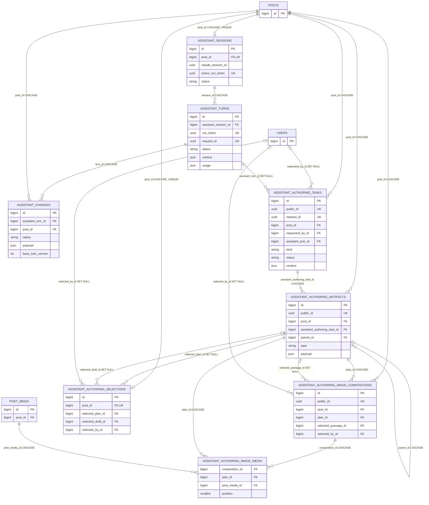
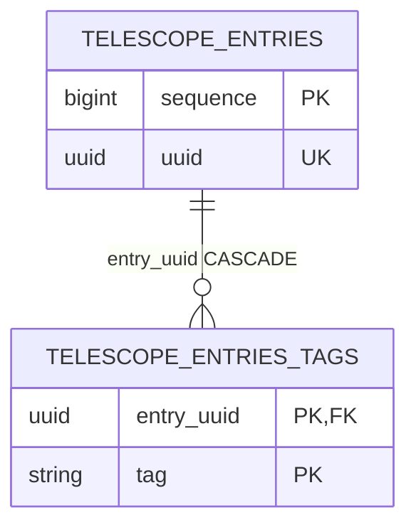

# Database ERD and data dictionary

Holizuki uses PostgreSQL for normal development and production-family
persistence. The portable schema is defined by 36 committed migrations and
contains 54 base tables with 58 physical foreign keys.

This document describes the fresh-migration schema, not accidental state in one
database. The connected development database was compared with a fresh
migration on 2026-07-30. It has the same tables and foreign keys but predates
two committed migration edits: revision projection columns and draft-slug
uniqueness. Read the
[schema drift issue](known-issues.md#connected-postgresql-differs-from-the-portable-migration-schema)
before changing Publishing persistence.

## Schema groups

| Group                             | Tables | Owning code                                            |
| --------------------------------- | -----: | ------------------------------------------------------ |
| Identity and authentication       |      4 | `app/Domain/Identity`, Fortify, framework auth/session |
| Taxonomy, Publishing, and Reading |     12 | `app/Domain/{Taxonomy,Publishing,Reading}`             |
| Inbox and Community               |      3 | `app/Domain/{Inbox,Community}`                         |
| Assistant                         |      8 | `app/Domain/Assistant`                                 |
| Analytics                         |     18 | `app/Domain/Analytics`                                 |
| Framework infrastructure          |      9 | Laravel cache/queue/migration and Telescope            |
| Total                             |     54 |                                                        |

The diagrams show physical foreign keys. Deletion labels are part of the
contract: `CASCADE` removes dependents, while `SET NULL` preserves historical
rows. Logical identifiers without foreign keys are documented separately.

## Core content ERD

```mermaid
erDiagram
    USERS {
        bigint id PK
        string email UK
        string role
        string author_slug UK
        json social_links
    }
    PASSKEYS {
        bigint id PK
        bigint user_id FK
        string credential_id UK
        json credential
    }
    CATEGORIES {
        bigint id PK
        string name UK
        string slug UK
    }
    TAGS {
        bigint id PK
        string name UK
        string slug UK
    }
    POSTS {
        bigint id PK
        bigint author_id FK
        bigint updated_by_id FK
        bigint category_id FK
        bigint scheduled_revision_id FK
        string slug UK
        string status
        json body
        int lock_version
        timestamp deleted_at
    }
    POST_DRAFTS {
        bigint id PK
        bigint post_id FK, UK
        bigint author_id FK
        bigint category_id FK
        string slug UK
        json body
    }
    POST_REVISIONS {
        bigint id PK
        bigint post_id FK
        bigint editor_id FK
        int revision_number
        json snapshot
        json referenced_paths
        json referenced_media_ids
    }
    POST_MEDIA {
        bigint id PK
        bigint post_id FK
        string path UK
        string role
        string origin
        string status
    }
    POST_SOURCES {
        bigint id PK
        bigint post_id FK
        bigint created_by_id FK
        string kind
        string path UK
        string visibility
    }
    POST_REDIRECTS {
        bigint id PK
        bigint post_id FK
        string old_slug UK
    }
    POST_AUTHORING_JOURNEYS {
        bigint id PK
        bigint post_id FK, UK
        string kind
        string current_step
        json brief
    }
    POST_VIEWS {
        bigint id PK
        bigint post_id FK
        date viewed_on
        string visitor_hash
    }
    POST_TAG {
        bigint post_id PK, FK
        bigint tag_id PK, FK
    }
    POST_DRAFT_TAG {
        bigint post_draft_id PK, FK
        bigint tag_id PK, FK
    }
    COMMENTS {
        bigint id PK
        bigint post_id FK
        bigint user_id FK
        bigint moderated_by_id FK
        string status
        text body
        timestamp deleted_at
    }
    NEWSLETTER_SUBSCRIBERS {
        bigint id PK
        bigint source_post_id FK
        text email
        string email_hash UK
        string status
    }
    CONTACT_SUBMISSIONS {
        bigint id PK
        string email
        text message
        string ip_address
        timestamp read_at
    }

    USERS ||--o{ PASSKEYS : "user_id CASCADE"
    USERS o|--o{ POSTS : "author_id SET NULL"
    USERS o|--o{ POSTS : "updated_by_id SET NULL"
    CATEGORIES o|--o{ POSTS : "category_id SET NULL"
    POST_REVISIONS o|--o{ POSTS : "scheduled_revision_id SET NULL"

    POSTS ||--o| POST_DRAFTS : "post_id CASCADE, UNIQUE"
    USERS o|--o{ POST_DRAFTS : "author_id SET NULL"
    CATEGORIES o|--o{ POST_DRAFTS : "category_id SET NULL"

    POSTS ||--o{ POST_TAG : "post_id CASCADE"
    TAGS ||--o{ POST_TAG : "tag_id CASCADE"
    POST_DRAFTS ||--o{ POST_DRAFT_TAG : "post_draft_id CASCADE"
    TAGS ||--o{ POST_DRAFT_TAG : "tag_id CASCADE"

    POSTS ||--o{ POST_REVISIONS : "post_id CASCADE"
    USERS o|--o{ POST_REVISIONS : "editor_id SET NULL"
    POSTS ||--o{ POST_MEDIA : "post_id CASCADE"
    POSTS ||--o{ POST_SOURCES : "post_id CASCADE"
    USERS o|--o{ POST_SOURCES : "created_by_id SET NULL"
    POSTS ||--o{ POST_REDIRECTS : "post_id CASCADE"
    POSTS ||--o| POST_AUTHORING_JOURNEYS : "post_id CASCADE, UNIQUE"
    POSTS ||--o{ POST_VIEWS : "post_id CASCADE"

    POSTS ||--o{ COMMENTS : "post_id CASCADE"
    USERS ||--o{ COMMENTS : "user_id CASCADE"
    USERS o|--o{ COMMENTS : "moderated_by_id SET NULL"
    POSTS o|--o{ NEWSLETTER_SUBSCRIBERS : "source_post_id SET NULL"
```

`contact_submissions` is intentionally standalone. `sessions.user_id`,
`password_reset_tokens.email`, and the two authentication infrastructure tables
are logical identity references without database foreign keys.

## Assistant ERD

The database does not prove that duplicated post/task/artifact/turn/media
references all belong to the same post. Use Assistant actions, which enforce
ownership and locking; do not insert these records directly.

## Analytics ERD

Only Analytics tables with a physical user/post foreign key appear in this
diagram. The remaining aggregate and operational tables are independent by
design and are listed in the catalog below.

```mermaid
erDiagram
    POSTS {
        bigint id PK
    }
    USERS {
        bigint id PK
    }
    ANALYTICS_DAILY_POST_METRICS {
        bigint id PK
        bigint post_id FK
        date metric_date
        string content_key
    }
    ANALYTICS_WEEKLY_POST_METRICS {
        bigint id PK
        bigint post_id FK
        smallint iso_year
        smallint iso_week
        string content_key
    }
    ANALYTICS_URL_ALIASES {
        bigint id PK
        bigint post_id FK
        string path UK
        string content_key
    }
    ANALYTICS_INSIGHTS {
        bigint id PK
        bigint user_id FK
        bigint post_id FK
        string rule_id
        string scope_key
        string status
    }
    ANALYTICS_MILESTONES {
        bigint id PK
        bigint user_id FK
        string code
        string scope_key
    }
    ANALYTICS_MOMENTUM_SNAPSHOTS {
        bigint id PK
        bigint user_id FK
        date scored_on
        smallint score
    }
    ANALYTICS_SETTINGS {
        bigint id PK
        bigint updated_by_id FK
        string key UK
        json value
    }
    ANALYTICS_SNAPSHOT_PREPARATIONS {
        bigint id PK
        bigint requested_by_id FK
        string preparation_key UK
        string status
    }
    AUTHOR_ACTIVITY_EVENTS {
        bigint id PK
        bigint user_id FK
        bigint post_id
        string event_key UK
    }
    AUTHOR_PRODUCT_EVENTS {
        bigint id PK
        bigint user_id FK
        string deduplication_key UK
    }
    AUTHOR_PUBLICATIONS {
        bigint id PK
        bigint post_id UK
        bigint author_id FK
    }

    POSTS o|--o{ ANALYTICS_DAILY_POST_METRICS : "post_id SET NULL"
    POSTS o|--o{ ANALYTICS_WEEKLY_POST_METRICS : "post_id SET NULL"
    POSTS o|--o{ ANALYTICS_URL_ALIASES : "post_id SET NULL"
    POSTS o|--o{ ANALYTICS_INSIGHTS : "post_id SET NULL"
    USERS ||--o{ ANALYTICS_INSIGHTS : "user_id CASCADE"
    USERS o|--o{ ANALYTICS_MILESTONES : "user_id SET NULL"
    USERS ||--o{ ANALYTICS_MOMENTUM_SNAPSHOTS : "user_id CASCADE"
    USERS o|--o{ ANALYTICS_SETTINGS : "updated_by_id SET NULL"
    USERS o|--o{ ANALYTICS_SNAPSHOT_PREPARATIONS : "requested_by_id SET NULL"
    USERS o|--o{ AUTHOR_ACTIVITY_EVENTS : "user_id SET NULL"
    USERS ||--o{ AUTHOR_PRODUCT_EVENTS : "user_id CASCADE"
    USERS o|--o{ AUTHOR_PUBLICATIONS : "author_id SET NULL"
```

`author_publications.post_id` and `author_activity_events.post_id` are
deliberate logical references without foreign keys so historical evidence can
outlive a post. `content_key` and `scope_key` are stable analytics identifiers,
not relational keys.

## Framework relationship

The only physical foreign key outside the domain diagrams is Telescope's
entry-tag cascade:

Cache, queue, migration, session, reset-token, and Telescope monitoring tables
otherwise have no physical foreign keys.

## Data dictionary

### Identity and authentication

| Table                   | Purpose and important constraints                                                                                                                   |
| ----------------------- | --------------------------------------------------------------------------------------------------------------------------------------------------- |
| `users`                 | Authentication principal, administrator/reader role, optional author profile, and authoring preferences. Unique email; nullable unique author slug. |
| `passkeys`              | Fortify WebAuthn credentials. User deletion cascades; credential ID is globally unique.                                                             |
| `password_reset_tokens` | Email-keyed reset-token store with no user FK.                                                                                                      |
| `sessions`              | Database-backed sessions. `user_id` is indexed but intentionally unconstrained; payload and user agent are sensitive.                               |

### Taxonomy, Publishing, and Reading

| Table                     | Purpose and important constraints                                                                                                                                                            |
| ------------------------- | -------------------------------------------------------------------------------------------------------------------------------------------------------------------------------------------- |
| `categories`              | Category vocabulary. Name and slug are unique; deleting a category nulls live/draft references.                                                                                              |
| `tags`                    | Tag vocabulary. Name and slug are unique.                                                                                                                                                    |
| `posts`                   | Aggregate root and current reader-visible projection. Holds lifecycle/soft-delete timestamps, optimistic `lock_version`, SEO, reader metadata, and denormalized search text. Slug is unique. |
| `post_drafts`             | One mutable private working copy per post. Unique post FK and, in the portable schema, unique slug. Body is rich-text JSON.                                                                  |
| `post_tag`                | Public/live tag pivot with composite primary key; both FKs cascade.                                                                                                                          |
| `post_draft_tag`          | Private draft-tag pivot with composite primary key; both FKs cascade.                                                                                                                        |
| `post_revisions`          | Immutable sequential snapshots. `(post_id, revision_number)` is unique. The snapshot cast also writes reference projections for safe cleanup.                                                |
| `post_media`              | Per-post image library/inline uploads. Storage path is unique; role, placement, origin, status, priority, dimensions, alt text, caption, and notes describe use.                             |
| `post_sources`            | URL, note, or private document evidence. Creator sets null; post cascades; optional file path is unique.                                                                                     |
| `post_redirects`          | Historical slug redirects. Old slug is globally unique; post deletion cascades.                                                                                                              |
| `post_authoring_journeys` | One guided-authoring progress/preferences row per post.                                                                                                                                      |
| `post_views`              | Privacy-minimized daily visitor deduplication. `(post_id, viewed_on, visitor_hash)` is unique; no update timestamp.                                                                          |

Important Publishing behavior:

- Creating a `Post` automatically creates its draft.
- Scheduling is a draft-status post with both `scheduled_at` and
  `scheduled_revision_id`; there is no separate scheduled enum value.
- Soft deletion retains dependent rows because the post row is not physically
  deleted. `ForceDeletePost` removes storage files and activates the cascade
  graph.
- PostgreSQL adds a GIN English full-text index over `posts.search_text`.
- An application-level post-media cap limits a post to 20 media records.

### Inbox and Community

| Table                    | Purpose and important constraints                                                                                                                       |
| ------------------------ | ------------------------------------------------------------------------------------------------------------------------------------------------------- |
| `contact_submissions`    | Contact PII/message with optional IP, user agent, and read timestamp. No FK or automated retention.                                                     |
| `comments`               | Reader comment and moderation lifecycle. Post/user delete cascades; moderator sets null. Body may be erased while hash and audit row remain.            |
| `newsletter_subscribers` | Double-opt-in state and attribution. Email is encrypted by the model; deterministic HMAC email hash and token hashes are unique. Source post sets null. |

### Assistant

| Table                                    | Purpose and important constraints                                                                                                                       |
| ---------------------------------------- | ------------------------------------------------------------------------------------------------------------------------------------------------------- |
| `assistant_sessions`                     | Exactly one resumable co-writer session per post. Post and active run token are unique.                                                                 |
| `assistant_turns`                        | One agent invocation with prompt/result, context, snapshots, usage/cost, timing, and sanitized failure state. Run and request UUIDs are unique.         |
| `assistant_changes`                      | Reviewable proposals with JSON payload and base lock version. Turn and post both cascade.                                                               |
| `assistant_authoring_tasks`              | Queued structured authoring jobs. Public/request UUIDs are unique. PostgreSQL permits only one queued/running task per post via a partial unique index. |
| `assistant_authoring_artifacts`          | Immutable plan, draft, research, or image artifacts with parent chains, group ordering, public UUID, and JSON payload.                                  |
| `assistant_authoring_selections`         | One selected plan/draft state per post; selected artifacts and selecting user set null.                                                                 |
| `assistant_authoring_image_compositions` | Ordered per-plan image decisions; `(plan_id, position)` is unique.                                                                                      |
| `assistant_authoring_image_media`        | Composition/media pivot with no standalone primary key. Uniqueness covers plan/media and composition/position.                                          |

### Analytics

The aggregate metric vector includes readers, meaningful/actioning readers,
sessions, page views, progress thresholds, engagement, content selection,
shares, sign-ups, comment submissions, outbound clicks, and downloads. Values
default to zero and carry `synced_at`.

| Table                                | Purpose and important constraints                                                                                 |
| ------------------------------------ | ----------------------------------------------------------------------------------------------------------------- |
| `analytics_daily_site_metrics`       | One site-wide aggregate per date.                                                                                 |
| `analytics_daily_post_metrics`       | Per-content daily aggregate, unique by date/content key. Nullable post FK preserves history.                      |
| `analytics_daily_channel_metrics`    | Daily acquisition-channel aggregate, unique by date/channel.                                                      |
| `analytics_weekly_site_metrics`      | Site aggregate unique by ISO year/week.                                                                           |
| `analytics_weekly_post_metrics`      | Per-content weekly aggregate unique by ISO year/week/content key. Nullable post FK preserves history.             |
| `analytics_period_snapshots`         | Site/post/channel comparison snapshots for arbitrary ranges with previous-period counters. Scope/range is unique. |
| `analytics_dimension_period_metrics` | Ranked dimension values for a period, unique by dimension/value/range.                                            |
| `analytics_url_aliases`              | Unique canonical/retired URL-to-content-key mapping; post sets null.                                              |
| `analytics_unmapped_paths`           | Unique imported paths that cannot yet map to content.                                                             |
| `analytics_sync_runs`                | Import audit/health record with UUID, range, quota, counts, status, and sanitized error.                          |
| `analytics_snapshot_preparations`    | Deduplicated asynchronous custom-range preparation with unique key; requester sets null.                          |
| `analytics_settings`                 | JSON key/value settings with unique key and optional last editor.                                                 |
| `analytics_momentum_snapshots`       | Per-user daily momentum; `(user_id, scored_on)` is unique and user deletion cascades.                             |
| `analytics_milestones`               | Idempotent achievements unique by code/scope; user sets null.                                                     |
| `analytics_insights`                 | Idempotent recommendations unique by rule/scope; user cascades and post sets null.                                |
| `author_publications`                | First-publication ledger unique by logical post ID; author sets null.                                             |
| `author_product_events`              | Deduplicated per-user product activity with expiry; user cascades.                                                |
| `author_activity_events`             | Publishing/maintenance activity with expiry; optional user sets null and post ID is logical.                      |

### Framework infrastructure

| Tables                                                                | Purpose                                                                                     |
| --------------------------------------------------------------------- | ------------------------------------------------------------------------------------------- |
| `cache`, `cache_locks`                                                | Database cache and atomic locks.                                                            |
| `jobs`, `job_batches`, `failed_jobs`                                  | Queue, batch, and failure persistence. Job payloads and failed exceptions may be sensitive. |
| `migrations`                                                          | Migration ledger.                                                                           |
| `telescope_entries`, `telescope_entries_tags`, `telescope_monitoring` | Local Telescope telemetry. Tags cascade from entries.                                       |

There is no scheduled `telescope:prune`; telemetry growth is an explicit
operational responsibility.

## Constraints and database-owned invariants

- Database `CHECK` constraints cover Analytics insight confidence/status,
  momentum freshness/level, period scope type, snapshot-preparation status,
  sync-run status, Community comment status, and subscriber status.
- Other PHP string-backed enums—post, user, assistant, media, source, journey,
  and revision state—are not database-checked. Use enum classes and domain
  actions.
- JSON columns are `json`, not `jsonb`, and have no JSON indexes.
- PostgreSQL does not enforce Laravel unsigned-integer semantics.
- There are no application table triggers. Projections and side effects are
  PHP-owned.
- The database cannot guarantee that `posts.scheduled_revision_id` belongs to
  the same post.
- The database cannot guarantee same-post ownership across every Assistant
  turn/task/artifact/selection/composition/media reference.
- `assistant_changes.post_id` is independent of the turn session's post ID.
- The one-active-guided-task rule is a PostgreSQL partial unique index on
  `assistant_authoring_tasks(post_id)` for `queued`/`running`.
- `assistant_authoring_image_media` intentionally has no primary key.

## Retention and sensitive data

| Data                                                                                                         | Current lifecycle                                                                                                                                                                           |
| ------------------------------------------------------------------------------------------------------------ | ------------------------------------------------------------------------------------------------------------------------------------------------------------------------------------------- |
| Post revisions                                                                                               | Capped by `BLOG_REVISION_LIMIT` (default 50) per post. The currently scheduled revision is retained. Files no longer referenced by live/draft/remaining revisions are deleted after commit. |
| Post views                                                                                                   | Rows older than 90 days are pruned daily.                                                                                                                                                   |
| Inline editor media                                                                                          | After one day, deleted only when absent from live content, draft content, and retained revisions. Library uploads are not auto-pruned.                                                      |
| Pending subscribers                                                                                          | Deleted after 7 days without confirmation.                                                                                                                                                  |
| Unsubscribed subscribers                                                                                     | Email and token hashes are erased immediately; deterministic email hash and consent/audit row remain.                                                                                       |
| Rejected comments                                                                                            | Deleted after 90 days.                                                                                                                                                                      |
| Reader-deleted comments                                                                                      | Body erased after 30 days; audit row/hash remain.                                                                                                                                           |
| Assistant turns/sessions/workspaces/transcripts                                                              | Default 30-day cutoff for inactive turns without proposed changes and idle empty sessions. Structured authoring tasks/artifacts are not included and remain until post cascade.             |
| Analytics sync runs                                                                                          | Completed runs older than 180 days are deleted daily.                                                                                                                                       |
| Author activity/product events                                                                               | Deleted at their `expires_at`; normal creation uses a 24-month expiry.                                                                                                                      |
| Contact submissions                                                                                          | No automated retention found.                                                                                                                                                               |
| Confirmed subscriber audit rows, approved/deleted comment rows, analytics aggregates, failed jobs, Telescope | No automated row-retention policy found.                                                                                                                                                    |

Sensitive stores include contact PII, encrypted subscriber email, private post
source documents, assistant prompts/context/workspaces/transcripts, session and
job payloads, failed-job exceptions, and Telescope content. Do not copy them
into fixtures, prompts, screenshots, logs, or documentation.

## Factory defaults that affect tests

- `UserFactory` defaults to an administrator, while the model/database default
  is reader. Use `reader()` explicitly for public-account/comment tests.
- `PostFactory` creates an author/category, receives a draft from the model
  event, ensures it with `firstOrCreate`, and rebuilds reader metadata.
- `PostFactory::scheduled()` creates the frozen scheduled revision.
- `AssistantTurnFactory` defaults to completed while the model defaults to
  running; use `running()` for lease/state tests.
- `AuthoringTaskFactory` defaults to completed while the model/database default
  is queued; use `queued()` for active-slot tests.
- Comment and newsletter factory states stamp/erase the same lifecycle fields
  as production actions.
- Every domain model/factory pair explicitly targets its model because models
  do not live under `App\Models`.

## Safe schema-change procedure

1. Inspect the target environment with Laravel Boost `database-schema`
   (summary first, then filtered detail).
2. Read every migration affecting the table plus model casts/relationships and
   query consumers.
3. Create a new migration; never modify a migration that may already have run.
4. Specify nullability, defaults, indexes, uniqueness, and delete behavior
   deliberately.
5. Update factories/seeders and focused feature tests.
6. Run the focused SQLite test, then PostgreSQL-sensitive coverage for JSON,
   full-text, partial indexes, locks, or driver-specific expressions.
7. Compare migration status and target schema after deployment.
8. Update this ERD/data dictionary and any affected known issue.
